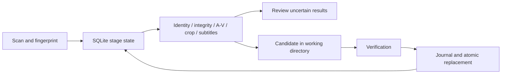

# Media Manager

Stateful Linux CLI and authenticated web dashboard for media inspection, subtitle synchronization, A/V correction, and conservative crop analysis.

- Scan libraries and track work in SQLite with resumable checkpoints.
- Review uncertain outcomes and retry selected processing stages.
- Analyze lip sync with optional SyncNet models and verify constant-offset corrections.
- Analyze persistent black borders and apply supported H.264 crop metadata without re-encoding.
- Find and synchronize local, embedded, or optionally downloaded subtitles.
- Manage multiple libraries through a shared web dashboard.

**Processing can replace media and subtitle files. Keep backups and inspect `plan` first. A successful command is not a guarantee of perceptual quality.** Model uncertainty and missing evidence can leave work unresolved. Keep private `.media-manager/` state and credentials out of Git.

## Quick start: inspect a disposable library

Requires Linux, Python 3.11+, and FFmpeg/ffprobe on PATH. From this checkout:

```bash
python3 -m venv .venv
. .venv/bin/activate
pip install -e '.[dev]'
media-manager --help
mkdir -p /tmp/media-manager-demo/Movies
cd /tmp/media-manager-demo
media-manager init
media-manager plan
```

This creates state and a plan; it does not run repairs. Use a fresh directory or copies of your own media for evaluation. See the [recorded synthetic demo](docs/demo.txt) and [reproduction script](scripts/demo.sh). The demo performs no model downloads or media repairs.

To use real libraries, first read [safety](docs/SAFETY.md) and the [operations reference](docs/OPERATIONS.md). A/V analysis needs the optional `avsync` extra and downloaded weights; language detection and subtitle providers have separate setup. Do not interpret missing models as verified sync.

## Pipeline



[Architecture](docs/ARCHITECTURE.md) · [Design decisions](docs/DECISIONS.md) · [CLI](docs/CLI.md) · [Portfolio case study](https://hijaz.dev/applied-ai/media-manager/)

## Support and limitations

| Area | Requirement / limit |
| --- | --- |
| Runtime | Linux; package requires Python 3.11+ |
| Core tools | FFmpeg, ffprobe, NumPy, ffsubsync |
| Crop | Lossless metadata crop supports H.264; uncertain geometry needs review |
| A/V | Optional model stack; speaking-face evidence may be absent in animation/dubs |
| Not implemented | Audio stretching/drift correction and content filtering |
| Web | For local evaluation use `media-manager web --host 127.0.0.1`; default host is all interfaces |
| Docker | Follow preserved [multi-library and authentication setup](docs/OPERATIONS.md#docker); do not delete the state volume |

## Development

```bash
pip install -e '.[dev]'
pytest
pip install build
python -m build
```

CI runs core tests, including FFmpeg integration, and builds distributions. Optional live-model/provider behavior and real media quality require separate validation. No hosted CI success badge is claimed before a run exists.

MIT license: [LICENSE](LICENSE). See [security guidance](SECURITY.md).
